# Dictionnaire de données : VCTMetaLens

Généré par pbip-generator : 15 tables, 43 mesures, 32 relations.

## Tables

| Table | Rôle | Source | Lignes | Colonnes | Mesures |
|---|---|---|---:|---:|---:|
| fact_agent_picks | faits | `fact_agent_picks.csv` | 0 | 7 | 2 |
| fact_draft | faits | `fact_draft.csv` | 0 | 7 | 1 |
| fact_eco | faits | `fact_eco.csv` | 0 | 9 | 3 |
| fact_map_score | faits | `fact_map_score.csv` | 0 | 10 | 5 |
| fact_map_stats | faits | `fact_map_stats.csv` | 0 | 7 | 4 |
| fact_match_team | faits | `fact_match_team.csv` | 0 | 9 | 4 |
| fact_multikills | faits | `fact_multikills.csv` | 0 | 19 | 10 |
| fact_player_map | faits | `fact_player_map.csv` | 0 | 18 | 10 |
| fact_round_methods | faits | `fact_round_methods.csv` | 0 | 9 | 2 |
| fact_team_agent_map | faits | `fact_team_agent_map.csv` | 0 | 8 | 2 |
| dim_agent | dimension | `dim_agent.csv` | 0 | 3 | 0 |
| dim_map | dimension | `dim_map.csv` | 0 | 1 | 0 |
| dim_player | dimension | `dim_player.csv` | 0 | 1 | 0 |
| dim_team | dimension | `dim_team.csv` | 0 | 2 | 0 |
| dim_tournament | dimension | `dim_tournament.csv` | 0 | 6 | 0 |

## Schéma du modèle

```mermaid
erDiagram
    T0["fact_agent_picks (faits)"] {
        string tournament FK
        string map FK
        string agent FK
    }
    T1["fact_draft (faits)"] {
        string tournament FK
        string team FK
        string map FK
    }
    T2["fact_eco (faits)"] {
        string tournament FK
        string map FK
        string team FK
    }
    T3["fact_map_score (faits)"] {
        string tournament FK
        string map FK
    }
    T4["fact_map_stats (faits)"] {
        string tournament FK
        string map FK
    }
    T5["fact_match_team (faits)"] {
        string tournament FK
        string team FK
    }
    T6["fact_multikills (faits)"] {
        string tournament FK
        string map FK
        string team FK
        string player FK
        string agent FK
    }
    T7["fact_player_map (faits)"] {
        string tournament FK
        string map FK
        string player FK
        string team FK
        string agent FK
    }
    T8["fact_round_methods (faits)"] {
        string tournament FK
        string map FK
        string team FK
    }
    T9["fact_team_agent_map (faits)"] {
        string tournament FK
        string map FK
        string team FK
        string agent FK
    }
    T10["dim_agent (dimension)"] {
        string agent PK
    }
    T11["dim_map (dimension)"] {
        string map PK
    }
    T12["dim_player (dimension)"] {
        string player PK
    }
    T13["dim_team (dimension)"] {
        string team PK
    }
    T14["dim_tournament (dimension)"] {
        string tournament PK
    }
    T0 }o--|| T14 : "tournament"
    T0 }o--|| T11 : "map"
    T0 }o--|| T10 : "agent"
    T4 }o--|| T14 : "tournament"
    T4 }o--|| T11 : "map"
    T9 }o--|| T14 : "tournament"
    T9 }o--|| T11 : "map"
    T9 }o--|| T13 : "team"
    T9 }o--|| T10 : "agent"
    T7 }o--|| T14 : "tournament"
    T7 }o--|| T11 : "map"
    T7 }o--|| T12 : "player"
    T7 }o--|| T13 : "team"
    T7 }o--|| T10 : "agent"
    T5 }o--|| T14 : "tournament"
    T5 }o--|| T13 : "team"
    T2 }o--|| T14 : "tournament"
    T2 }o--|| T11 : "map"
    T2 }o--|| T13 : "team"
    T8 }o--|| T14 : "tournament"
    T8 }o--|| T11 : "map"
    T8 }o--|| T13 : "team"
    T1 }o--|| T14 : "tournament"
    T1 }o--|| T13 : "team"
    T1 }o--|| T11 : "map"
    T6 }o--|| T14 : "tournament"
    T6 }o--|| T11 : "map"
    T6 }o--|| T13 : "team"
    T6 }o--|| T12 : "player"
    T6 }o--|| T10 : "agent"
    T3 }o--|| T14 : "tournament"
    T3 }o--|| T11 : "map"
```



### fact_agent_picks

| Colonne | Type | Format | Masquée |
|---|---|---|---|
| tournament | string |  | oui |
| stage | string |  | non |
| match_type | string |  | non |
| map | string |  | oui |
| agent | string |  | oui |
| pick_rate | double |  | oui |
| maps_played | int64 |  | oui |

### fact_draft

| Colonne | Type | Format | Masquée |
|---|---|---|---|
| tournament | string |  | oui |
| stage | string |  | non |
| match_type | string |  | non |
| match_name | string |  | non |
| team | string |  | oui |
| action | string |  | non |
| map | string |  | oui |

### fact_eco

| Colonne | Type | Format | Masquée |
|---|---|---|---|
| tournament | string |  | oui |
| stage | string |  | non |
| match_type | string |  | non |
| match_name | string |  | non |
| map | string |  | oui |
| team | string |  | oui |
| buy_category | string |  | non |
| initiated | double |  | oui |
| won | double |  | oui |

### fact_map_score

| Colonne | Type | Format | Masquée |
|---|---|---|---|
| tournament | string |  | oui |
| stage | string |  | non |
| match_type | string |  | non |
| match_name | string |  | non |
| map | string |  | oui |
| team_a_score | int64 |  | oui |
| team_b_score | int64 |  | oui |
| team_a_overtime_score | double |  | oui |
| team_b_overtime_score | double |  | oui |
| duration_seconds | double |  | oui |

### fact_map_stats

| Colonne | Type | Format | Masquée |
|---|---|---|---|
| tournament | string |  | oui |
| stage | string |  | non |
| match_type | string |  | non |
| map | string |  | oui |
| total_maps_played | int64 |  | oui |
| attacker_side_win_percentage | double |  | oui |
| defender_side_win_percentage | double |  | oui |

### fact_match_team

| Colonne | Type | Format | Masquée |
|---|---|---|---|
| tournament | string |  | oui |
| stage | string |  | non |
| match_type | string |  | non |
| match_name | string |  | non |
| team | string |  | oui |
| opponent | string |  | non |
| maps_won | int64 |  | oui |
| maps_lost | int64 |  | oui |
| won | boolean |  | non |

### fact_multikills

| Colonne | Type | Format | Masquée |
|---|---|---|---|
| tournament | string |  | oui |
| stage | string |  | non |
| match_type | string |  | non |
| match_name | string |  | non |
| map | string |  | oui |
| team | string |  | oui |
| player | string |  | oui |
| agent | string |  | oui |
| 2k | double |  | oui |
| 3k | double |  | oui |
| 4k | double |  | oui |
| 5k | double |  | oui |
| 1v1 | double |  | oui |
| 1v2 | double |  | oui |
| 1v3 | double |  | oui |
| 1v4 | double |  | oui |
| 1v5 | double |  | oui |
| spike_plants | int64 |  | oui |
| spike_defuses | int64 |  | oui |

### fact_player_map

| Colonne | Type | Format | Masquée |
|---|---|---|---|
| tournament | string |  | oui |
| stage | string |  | non |
| match_type | string |  | non |
| match_name | string |  | non |
| map | string |  | oui |
| player | string |  | oui |
| team | string |  | oui |
| agent | string |  | oui |
| rating | double |  | oui |
| average_combat_score | double |  | oui |
| kills | double |  | oui |
| deaths | double |  | oui |
| assists | double |  | oui |
| average_damage_per_round | double |  | oui |
| first_kills | double |  | oui |
| first_deaths | double |  | oui |
| headshot_pct | double |  | oui |
| kast_pct | double |  | oui |

### fact_round_methods

| Colonne | Type | Format | Masquée |
|---|---|---|---|
| tournament | string |  | oui |
| stage | string |  | non |
| match_type | string |  | non |
| match_name | string |  | non |
| map | string |  | oui |
| round_number | int64 |  | oui |
| team | string |  | oui |
| method | string |  | non |
| outcome | string |  | non |

### fact_team_agent_map

| Colonne | Type | Format | Masquée |
|---|---|---|---|
| tournament | string |  | oui |
| stage | string |  | non |
| match_type | string |  | non |
| map | string |  | oui |
| team | string |  | oui |
| agent | string |  | oui |
| total_wins_by_map | int64 |  | oui |
| total_maps_played | int64 |  | oui |

### dim_agent

| Colonne | Type | Format | Masquée |
|---|---|---|---|
| agent | string |  | non |
| agent_label | string |  | non |
| role | string |  | non |

### dim_map

| Colonne | Type | Format | Masquée |
|---|---|---|---|
| map | string |  | non |

### dim_player

| Colonne | Type | Format | Masquée |
|---|---|---|---|
| player | string |  | non |

### dim_team

| Colonne | Type | Format | Masquée |
|---|---|---|---|
| team | string |  | non |
| team_abbr | string |  | non |

### dim_tournament

| Colonne | Type | Format | Masquée |
|---|---|---|---|
| tournament | string |  | non |
| tournament_short | string |  | non |
| season_order | int64 |  | oui |
| region | string |  | non |
| tier | string |  | non |
| phase_order | int64 |  | oui |

## Relations

| De (plusieurs) | Vers (un) | Active |
|---|---|---|
| fact_agent_picks[tournament] | dim_tournament[tournament] | oui |
| fact_agent_picks[map] | dim_map[map] | oui |
| fact_agent_picks[agent] | dim_agent[agent] | oui |
| fact_map_stats[tournament] | dim_tournament[tournament] | oui |
| fact_map_stats[map] | dim_map[map] | oui |
| fact_team_agent_map[tournament] | dim_tournament[tournament] | oui |
| fact_team_agent_map[map] | dim_map[map] | oui |
| fact_team_agent_map[team] | dim_team[team] | oui |
| fact_team_agent_map[agent] | dim_agent[agent] | oui |
| fact_player_map[tournament] | dim_tournament[tournament] | oui |
| fact_player_map[map] | dim_map[map] | oui |
| fact_player_map[player] | dim_player[player] | oui |
| fact_player_map[team] | dim_team[team] | oui |
| fact_player_map[agent] | dim_agent[agent] | oui |
| fact_match_team[tournament] | dim_tournament[tournament] | oui |
| fact_match_team[team] | dim_team[team] | oui |
| fact_eco[tournament] | dim_tournament[tournament] | oui |
| fact_eco[map] | dim_map[map] | oui |
| fact_eco[team] | dim_team[team] | oui |
| fact_round_methods[tournament] | dim_tournament[tournament] | oui |
| fact_round_methods[map] | dim_map[map] | oui |
| fact_round_methods[team] | dim_team[team] | oui |
| fact_draft[tournament] | dim_tournament[tournament] | oui |
| fact_draft[team] | dim_team[team] | oui |
| fact_draft[map] | dim_map[map] | oui |
| fact_multikills[tournament] | dim_tournament[tournament] | oui |
| fact_multikills[map] | dim_map[map] | oui |
| fact_multikills[team] | dim_team[team] | oui |
| fact_multikills[player] | dim_player[player] | oui |
| fact_multikills[agent] | dim_agent[agent] | oui |
| fact_map_score[tournament] | dim_tournament[tournament] | oui |
| fact_map_score[map] | dim_map[map] | oui |

## Mesures

| Mesure | Table | Dossier | Format | Description |
|---|---|---|---|---|
| Pick rate % | fact_agent_picks | Méta agents | `0.0%` | Pick rate pondéré par le nombre de maps jouées (jamais une moyenne simple des pourcentages). |
| Agents joués | fact_agent_picks | Méta agents | `0` |  |
| Maps jouées | fact_map_stats | Maps | `#,0` |  |
| Winrate attaque % | fact_map_stats | Maps | `0.0%` |  |
| Winrate défense % | fact_map_stats | Maps | `0.0%` |  |
| Écart DEF - ATK (pts) | fact_map_stats | Maps | `+0.0;-0.0;0.0` |  |
| Maps avec l'agent | fact_team_agent_map | Méta agents | `#,0` | Maps où l'équipe a aligné l'agent (une map compte une fois par agent de la compo). |
| Winrate compo % | fact_team_agent_map | Méta agents | `0.0%` | Part des maps gagnées quand l'équipe joue l'agent. |
| Maps joueur | fact_player_map | Joueurs | `#,0` |  |
| Rating moyen | fact_player_map | Joueurs | `0.00` |  |
| ACS moyen | fact_player_map | Joueurs | `0` |  |
| ADR moyen | fact_player_map | Joueurs | `0` |  |
| K/D | fact_player_map | Joueurs | `0.00` |  |
| FK/FD | fact_player_map | Joueurs | `0.00` |  |
| HS % | fact_player_map | Joueurs | `0.0%` |  |
| KAST % | fact_player_map | Joueurs | `0.0%` |  |
| Rating (10 maps min.) | fact_player_map | Joueurs | `0.00` | Vide sous 10 maps : évite qu'un remplaçant à 2 maps domine le classement. |
| ACS (10 maps min.) | fact_player_map | Joueurs | `0` |  |
| Matchs | fact_match_team | Équipes | `#,0` |  |
| Victoires | fact_match_team | Équipes | `#,0` |  |
| Winrate matchs % | fact_match_team | Équipes | `0.0%` |  |
| Maps gagnées % | fact_match_team | Équipes | `0.0%` |  |
| Rounds éco joués | fact_eco | Équipes | `#,0` |  |
| Conversion éco % | fact_eco | Équipes | `0.0%` |  |
| Pistols gagnés % | fact_eco | Équipes | `0.0%` |  |
| Rounds gagnés | fact_round_methods | Maps | `#,0` |  |
| Part des rounds gagnés % | fact_round_methods | Maps | `0.0%` |  |
| Actions de draft | fact_draft | Maps | `#,0` |  |
| Clutchs gagnés | fact_multikills | Duels | `#,0` |  |
| Clutchs 1v3+ | fact_multikills | Duels | `#,0` |  |
| Clutchs par map | fact_multikills | Duels | `0.00` | Une ligne de fact_multikills = un joueur sur une map. |
| Multikills 2K | fact_multikills | Duels | `#,0` |  |
| Multikills 3K | fact_multikills | Duels | `#,0` |  |
| Multikills 4K | fact_multikills | Duels | `#,0` |  |
| Aces | fact_multikills | Duels | `#,0` |  |
| Multikills 3K+ | fact_multikills | Duels | `#,0` |  |
| Spikes plantés | fact_multikills | Duels | `#,0` |  |
| Spikes désamorcés | fact_multikills | Duels | `#,0` |  |
| Maps (scores) | fact_map_score | Maps | `#,0` |  |
| Durée moyenne (min) | fact_map_score | Maps | `0.0` |  |
| Prolongations % | fact_map_score | Maps | `0.0%` | Part des maps allées en prolongation (au moins un round d'overtime). |
| Écart de score moyen | fact_map_score | Maps | `0.0` |  |
| Rounds par map | fact_map_score | Maps | `0.0` |  |

### Pick rate %

Expression DAX (fact_agent_picks):

```dax
DIVIDE (
    SUMX ( fact_agent_picks, fact_agent_picks[pick_rate] * fact_agent_picks[maps_played] ),
    SUM ( fact_agent_picks[maps_played] )
) / 100
```

### Agents joués

Expression DAX (fact_agent_picks):

```dax
CALCULATE ( DISTINCTCOUNT ( fact_agent_picks[agent] ), fact_agent_picks[pick_rate] > 0 )
```

### Maps jouées

Expression DAX (fact_map_stats):

```dax
SUM ( fact_map_stats[total_maps_played] )
```

### Winrate attaque %

Expression DAX (fact_map_stats):

```dax
DIVIDE (
    SUMX ( fact_map_stats, fact_map_stats[attacker_side_win_percentage] * fact_map_stats[total_maps_played] ),
    [Maps jouées]
) / 100
```

### Winrate défense %

Expression DAX (fact_map_stats):

```dax
DIVIDE (
    SUMX ( fact_map_stats, fact_map_stats[defender_side_win_percentage] * fact_map_stats[total_maps_played] ),
    [Maps jouées]
) / 100
```

### Écart DEF - ATK (pts)

Expression DAX (fact_map_stats):

```dax
( [Winrate défense %] - [Winrate attaque %] ) * 100
```

### Maps avec l'agent

Expression DAX (fact_team_agent_map):

```dax
SUM ( fact_team_agent_map[total_maps_played] )
```

### Winrate compo %

Expression DAX (fact_team_agent_map):

```dax
DIVIDE ( SUM ( fact_team_agent_map[total_wins_by_map] ), SUM ( fact_team_agent_map[total_maps_played] ) )
```

### Maps joueur

Expression DAX (fact_player_map):

```dax
COUNTROWS ( fact_player_map )
```

### Rating moyen

Expression DAX (fact_player_map):

```dax
AVERAGE ( fact_player_map[rating] )
```

### ACS moyen

Expression DAX (fact_player_map):

```dax
AVERAGE ( fact_player_map[average_combat_score] )
```

### ADR moyen

Expression DAX (fact_player_map):

```dax
AVERAGE ( fact_player_map[average_damage_per_round] )
```

### K/D

Expression DAX (fact_player_map):

```dax
DIVIDE ( SUM ( fact_player_map[kills] ), SUM ( fact_player_map[deaths] ) )
```

### FK/FD

Expression DAX (fact_player_map):

```dax
DIVIDE ( SUM ( fact_player_map[first_kills] ), SUM ( fact_player_map[first_deaths] ) )
```

### HS %

Expression DAX (fact_player_map):

```dax
AVERAGE ( fact_player_map[headshot_pct] ) / 100
```

### KAST %

Expression DAX (fact_player_map):

```dax
AVERAGE ( fact_player_map[kast_pct] ) / 100
```

### Rating (10 maps min.)

Expression DAX (fact_player_map):

```dax
IF ( [Maps joueur] >= 10, [Rating moyen] )
```

### ACS (10 maps min.)

Expression DAX (fact_player_map):

```dax
IF ( [Maps joueur] >= 10, [ACS moyen] )
```

### Matchs

Expression DAX (fact_match_team):

```dax
COUNTROWS ( fact_match_team )
```

### Victoires

Expression DAX (fact_match_team):

```dax
CALCULATE ( COUNTROWS ( fact_match_team ), fact_match_team[won] = TRUE () )
```

### Winrate matchs %

Expression DAX (fact_match_team):

```dax
DIVIDE ( [Victoires], [Matchs] )
```

### Maps gagnées %

Expression DAX (fact_match_team):

```dax
DIVIDE (
    SUM ( fact_match_team[maps_won] ),
    SUM ( fact_match_team[maps_won] ) + SUM ( fact_match_team[maps_lost] )
)
```

### Rounds éco joués

Expression DAX (fact_eco):

```dax
SUM ( fact_eco[initiated] )
```

### Conversion éco %

Expression DAX (fact_eco):

```dax
DIVIDE ( SUM ( fact_eco[won] ), SUM ( fact_eco[initiated] ) )
```

### Pistols gagnés %

Expression DAX (fact_eco):

```dax
CALCULATE ( [Conversion éco %], fact_eco[buy_category] = "Pistol" )
```

### Rounds gagnés

Expression DAX (fact_round_methods):

```dax
CALCULATE ( COUNTROWS ( fact_round_methods ), fact_round_methods[outcome] = "Win" )
```

### Part des rounds gagnés %

Expression DAX (fact_round_methods):

```dax
DIVIDE ( [Rounds gagnés], CALCULATE ( [Rounds gagnés], REMOVEFILTERS ( fact_round_methods[method] ) ) )
```

### Actions de draft

Expression DAX (fact_draft):

```dax
COUNTROWS ( fact_draft )
```

### Clutchs gagnés

Expression DAX (fact_multikills):

```dax
SUM ( fact_multikills[1v1] ) + SUM ( fact_multikills[1v2] ) + SUM ( fact_multikills[1v3] )
    + SUM ( fact_multikills[1v4] ) + SUM ( fact_multikills[1v5] )
```

### Clutchs 1v3+

Expression DAX (fact_multikills):

```dax
SUM ( fact_multikills[1v3] ) + SUM ( fact_multikills[1v4] ) + SUM ( fact_multikills[1v5] )
```

### Clutchs par map

Expression DAX (fact_multikills):

```dax
DIVIDE ( [Clutchs gagnés], COUNTROWS ( fact_multikills ) )
```

### Multikills 2K

Expression DAX (fact_multikills):

```dax
SUM ( fact_multikills[2k] )
```

### Multikills 3K

Expression DAX (fact_multikills):

```dax
SUM ( fact_multikills[3k] )
```

### Multikills 4K

Expression DAX (fact_multikills):

```dax
SUM ( fact_multikills[4k] )
```

### Aces

Expression DAX (fact_multikills):

```dax
SUM ( fact_multikills[5k] )
```

### Multikills 3K+

Expression DAX (fact_multikills):

```dax
[Multikills 3K] + [Multikills 4K] + [Aces]
```

### Spikes plantés

Expression DAX (fact_multikills):

```dax
SUM ( fact_multikills[spike_plants] )
```

### Spikes désamorcés

Expression DAX (fact_multikills):

```dax
SUM ( fact_multikills[spike_defuses] )
```

### Maps (scores)

Expression DAX (fact_map_score):

```dax
COUNTROWS ( fact_map_score )
```

### Durée moyenne (min)

Expression DAX (fact_map_score):

```dax
AVERAGE ( fact_map_score[duration_seconds] ) / 60
```

### Prolongations %

Expression DAX (fact_map_score):

```dax
DIVIDE (
    COUNTROWS (
        FILTER (
            fact_map_score,
            fact_map_score[team_a_overtime_score] + fact_map_score[team_b_overtime_score] > 0
        )
    ),
    [Maps (scores)]
)
```

### Écart de score moyen

Expression DAX (fact_map_score):

```dax
AVERAGEX ( fact_map_score, ABS ( fact_map_score[team_a_score] - fact_map_score[team_b_score] ) )
```

### Rounds par map

Expression DAX (fact_map_score):

```dax
AVERAGEX ( fact_map_score, fact_map_score[team_a_score] + fact_map_score[team_b_score] )
```
