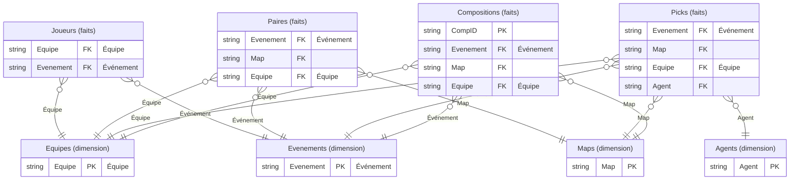

# Dictionnaire de données : VLR2026

Généré par pbip-generator : 8 tables, 26 mesures, 12 relations.

## Tables

| Table | Rôle | Source | Lignes | Colonnes | Mesures |
|---|---|---|---:|---:|---:|
| Compositions | faits | `Compositions.csv` | 3 164 | 10 | 6 |
| Joueurs | faits | `Joueurs.csv` | 1 022 | 15 | 8 |
| Paires | faits | `Paires.csv` | 31 640 | 6 | 3 |
| Picks | faits | `Picks.csv` | 15 820 | 6 | 8 |
| Agents | dimension | `Agents.csv` | 29 | 4 | 0 |
| Equipes | dimension | `Equipes.csv` | 63 | 4 | 1 |
| Evenements | dimension | `Evenements.csv` | 15 | 6 | 0 |
| Maps | dimension | `Maps.csv` | 12 | 1 | 0 |

## Schéma du modèle



## Grain des tables de faits

- **Compositions** : une ligne par `CompID`
- **Joueurs** : aucune combinaison de ses clés et de ses dates n'est unique : vérifier les doublons
- **Paires** : aucune combinaison de ses clés et de ses dates n'est unique : vérifier les doublons
- **Picks** : aucune combinaison de ses clés et de ses dates n'est unique : vérifier les doublons

### Compositions

| Colonne | Type | Format | Masquée |
|---|---|---|---|
| CompID | string |  | oui |
| Événement | string |  | oui |
| Map | string |  | oui |
| Équipe | string |  | oui |
| Adversaire | string |  | non |
| Match | string |  | oui |
| Résultat | string |  | non |
| Victoire | int64 | `#,##0` | oui |
| Agents | string |  | non |
| Archétype | string |  | non |

### Joueurs

| Colonne | Type | Format | Masquée |
|---|---|---|---|
| Joueur | string |  | non |
| Équipe | string |  | oui |
| Événement | string |  | oui |
| Rôle joué | string |  | non |
| Agents joués | string |  | non |
| Maps | int64 | `#,##0` | oui |
| Rounds | int64 | `#,##0` | oui |
| Rating | double | `#,##0.00` | oui |
| ACS | double | `#,##0.00` | oui |
| KD | double | `#,##0.00` | oui |
| KAST | double | `#,##0.00` | oui |
| ADR | double | `#,##0.00` | oui |
| FKPR | double | `#,##0.00` | oui |
| FDPR | double | `#,##0.00` | oui |
| HS | double | `#,##0.00` | oui |

### Paires

| Colonne | Type | Format | Masquée |
|---|---|---|---|
| CompID | string |  | oui |
| Événement | string |  | oui |
| Map | string |  | oui |
| Équipe | string |  | oui |
| Paire | string |  | non |
| Victoire | int64 | `#,##0` | oui |

### Picks

| Colonne | Type | Format | Masquée |
|---|---|---|---|
| CompID | string |  | oui |
| Événement | string |  | oui |
| Map | string |  | oui |
| Équipe | string |  | oui |
| Agent | string |  | oui |
| Victoire | int64 | `#,##0` | oui |

### Agents

| Colonne | Type | Format | Masquée |
|---|---|---|---|
| Agent | string |  | oui |
| Nom | string |  | non |
| Rôle | string |  | non |
| Ordre rôle | int64 | `#,##0` | oui |

### Equipes

| Colonne | Type | Format | Masquée |
|---|---|---|---|
| Équipe | string |  | non |
| Région | string |  | non |
| Profil tactique | string |  | non |
| Score profil | double | `#,##0.00` | oui |

### Evenements

| Colonne | Type | Format | Masquée |
|---|---|---|---|
| Événement | string |  | oui |
| Nom événement | string |  | non |
| Région | string |  | non |
| Phase | string |  | non |
| Étape | string |  | non |
| Ordre | int64 | `#,##0` | oui |

### Maps

| Colonne | Type | Format | Masquée |
|---|---|---|---|
| Map | string |  | non |

## Relations

| De (plusieurs) | Vers (un) | Active |
|---|---|---|
| Picks[Agent] | Agents[Agent] | oui |
| Compositions[Équipe] | Equipes[Équipe] | oui |
| Compositions[Événement] | Evenements[Événement] | oui |
| Compositions[Map] | Maps[Map] | oui |
| Picks[Équipe] | Equipes[Équipe] | oui |
| Picks[Événement] | Evenements[Événement] | oui |
| Picks[Map] | Maps[Map] | oui |
| Paires[Équipe] | Equipes[Équipe] | oui |
| Paires[Événement] | Evenements[Événement] | oui |
| Paires[Map] | Maps[Map] | oui |
| Joueurs[Équipe] | Equipes[Équipe] | oui |
| Joueurs[Événement] | Evenements[Événement] | oui |

## Mesures

| Mesure | Table | Dossier | Format | Description |
|---|---|---|---|---|
| Compositions | Compositions | Compositions | `#,##0` | Nombre de compositions jouées (une équipe, une map, cinq agents) |
| Maps jouées | Compositions | Compositions | `#,##0` | Nombre de maps jouées ; une map compte deux compositions, une par équipe |
| Compos différentes | Compositions | Compositions | `#,##0` | Nombre de combinaisons de cinq agents différentes |
| Diversité des compos | Compositions | Compositions | `0 %` | Part de compositions différentes ; 100 % = jamais deux fois la même, bas = compo fixe |
| Winrate | Compositions | Compositions | `0 %` | Part des maps gagnées par les compositions sélectionnées (50 % sur toutes les maps, par construction) |
| Couleur Winrate (masquée) | Compositions | Couleurs |  | Couleur de mise en évidence de Winrate |
| Score profil tactique | Equipes | Équipes | `0.0` | Score de 0 à 100 du modèle de profils sur la saison (stabilité des compos, pool d'agents, identité par map, fiabilité de l'échantillon), voir data/models/team_profile_scores.csv |
| Joueurs | Joueurs | Joueurs | `#,##0` | Nombre de joueurs différents |
| Rounds joués | Joueurs | Joueurs | `#,##0` | Rounds joués par les joueurs sélectionnés |
| Rating moyen | Joueurs | Joueurs | `0.00` | Rating vlr.gg pondéré par les rounds joués, pour qu'un remplaçant ne pèse pas autant qu'un titulaire |
| ACS moyen | Joueurs | Joueurs | `0` | Average combat score pondéré par les rounds |
| ADR moyen | Joueurs | Joueurs | `0` | Dégâts moyens par round, pondérés par les rounds |
| KAST moyen | Joueurs | Joueurs | `0 %` | Part des rounds avec un kill, une assist, une survie ou un trade, pondérée par les rounds |
| First kills - first deaths | Joueurs | Joueurs | `+0.00;-0.00;0.00` | Premiers kills moins premières morts, par round ; positif = gagne ses duels d'ouverture |
| Couleur Rating moyen (masquée) | Joueurs | Couleurs |  | Couleur de mise en évidence de Rating moyen |
| Pick rate paire | Paires | Paires | `0 %` | Part des compositions qui contiennent les deux agents de la paire |
| Winrate paire | Paires | Paires | `0 %` | Part des maps gagnées par les compositions qui contiennent la paire |
| Équipes (paire) | Paires | Paires | `#,##0` | Nombre d'équipes qui ont joué la paire ; une paire jouée par peu d'équipes est une signature, pas une méta |
| Pick rate | Picks | Agents | `0 %` | Part des compositions qui contiennent l'agent (ou au moins un agent du rôle), calculée sur les compositions du filtre en cours : le filtre agent ou rôle ne touche pas au dénominateur |
| Winrate de l'agent | Picks | Agents | `0 %` | Part des maps gagnées par les compositions qui contiennent l'agent |
| Maps avec l'agent | Picks | Agents | `#,##0` | Nombre de compositions qui contiennent l'agent ; sert à écarter les winrates sur trop peu de maps |
| Agents par compo | Picks | Agents | `0.00` | Nombre moyen d'agents du rôle par composition (ex. 1,3 duelliste par compo) |
| Agents joués | Picks | Agents | `#,##0` | Nombre d'agents différents joués au moins une fois |
| Équipes qui le jouent | Picks | Agents | `#,##0` | Nombre d'équipes qui ont joué l'agent au moins une fois |
| Couleur Winrate de l'agent (masquée) | Picks | Couleurs |  | Couleur de mise en évidence de Winrate de l'agent |
| Couleur Pick rate (masquée) | Picks | Couleurs |  | Couleur de mise en évidence de Pick rate |

### Compositions

Expression DAX (Compositions):

```dax
COUNTROWS(Compositions)
```

### Maps jouées

Expression DAX (Compositions):

```dax
DISTINCTCOUNT(Compositions[Match])
```

### Compos différentes

Expression DAX (Compositions):

```dax
DISTINCTCOUNT(Compositions[Agents])
```

### Diversité des compos

Expression DAX (Compositions):

```dax
DIVIDE([Compos différentes], [Compositions])
```

### Winrate

Expression DAX (Compositions):

```dax
AVERAGE(Compositions[Victoire])
```

### Couleur Winrate

Expression DAX (Compositions):

```dax
VAR _v = [Winrate]
RETURN SWITCH(
    TRUE(),
    ISBLANK(_v), BLANK(),
    _v < 0.45, "#E03131",
    _v < 0.55, "#F59F00",
    "#12B886"
)
```

### Score profil tactique

Expression DAX (Equipes):

```dax
AVERAGE(Equipes[Score profil])
```

### Joueurs

Expression DAX (Joueurs):

```dax
DISTINCTCOUNT(Joueurs[Joueur])
```

### Rounds joués

Expression DAX (Joueurs):

```dax
SUM(Joueurs[Rounds])
```

### Rating moyen

Expression DAX (Joueurs):

```dax
DIVIDE(SUMX(Joueurs, Joueurs[Rating] * Joueurs[Rounds]), [Rounds joués])
```

### ACS moyen

Expression DAX (Joueurs):

```dax
DIVIDE(SUMX(Joueurs, Joueurs[ACS] * Joueurs[Rounds]), [Rounds joués])
```

### ADR moyen

Expression DAX (Joueurs):

```dax
DIVIDE(SUMX(Joueurs, Joueurs[ADR] * Joueurs[Rounds]), [Rounds joués])
```

### KAST moyen

Expression DAX (Joueurs):

```dax
DIVIDE(SUMX(Joueurs, Joueurs[KAST] * Joueurs[Rounds]), [Rounds joués])
```

### First kills - first deaths

Expression DAX (Joueurs):

```dax
DIVIDE(SUMX(Joueurs, (Joueurs[FKPR] - Joueurs[FDPR]) * Joueurs[Rounds]), [Rounds joués])
```

### Couleur Rating moyen

Expression DAX (Joueurs):

```dax
VAR _v = [Rating moyen]
RETURN SWITCH(
    TRUE(),
    ISBLANK(_v), BLANK(),
    _v < 0.95, "#E03131",
    _v < 1.1, "#F59F00",
    "#12B886"
)
```

### Pick rate paire

Expression DAX (Paires):

```dax
DIVIDE(DISTINCTCOUNT(Paires[CompID]), [Compositions])
```

### Winrate paire

Expression DAX (Paires):

```dax
DIVIDE(CALCULATE(DISTINCTCOUNT(Paires[CompID]), Paires[Victoire] = 1), DISTINCTCOUNT(Paires[CompID]))
```

### Équipes (paire)

Expression DAX (Paires):

```dax
DISTINCTCOUNT(Paires[Équipe])
```

### Pick rate

Expression DAX (Picks):

```dax
DIVIDE(DISTINCTCOUNT(Picks[CompID]), [Compositions])
```

### Winrate de l'agent

Expression DAX (Picks):

```dax
DIVIDE(CALCULATE(DISTINCTCOUNT(Picks[CompID]), Picks[Victoire] = 1), DISTINCTCOUNT(Picks[CompID]))
```

### Maps avec l'agent

Expression DAX (Picks):

```dax
DISTINCTCOUNT(Picks[CompID])
```

### Agents par compo

Expression DAX (Picks):

```dax
DIVIDE(COUNTROWS(Picks), [Compositions])
```

### Agents joués

Expression DAX (Picks):

```dax
DISTINCTCOUNT(Picks[Agent])
```

### Équipes qui le jouent

Expression DAX (Picks):

```dax
DISTINCTCOUNT(Picks[Équipe])
```

### Couleur Winrate de l'agent

Expression DAX (Picks):

```dax
VAR _v = [Winrate de l'agent]
RETURN SWITCH(
    TRUE(),
    ISBLANK(_v), BLANK(),
    _v < 0.45, "#E03131",
    _v < 0.55, "#F59F00",
    "#12B886"
)
```

### Couleur Pick rate

Expression DAX (Picks):

```dax
VAR _v = [Pick rate]
RETURN SWITCH(
    TRUE(),
    ISBLANK(_v), BLANK(),
    _v < 0.1, "#677386",
    _v < 0.5, "#F59F00",
    "#FF4655"
)
```
